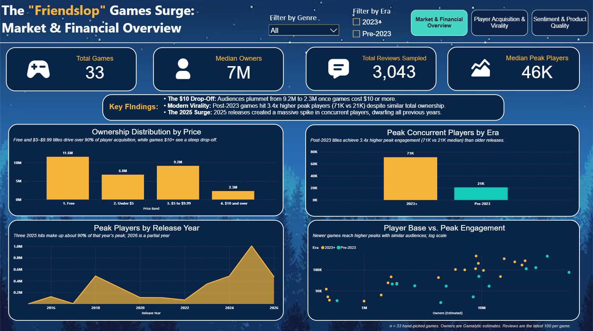
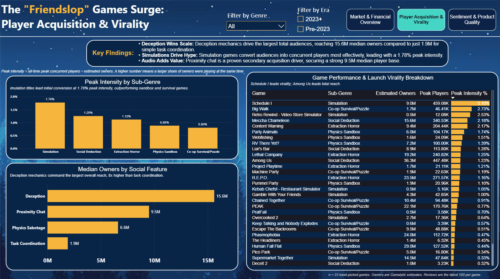
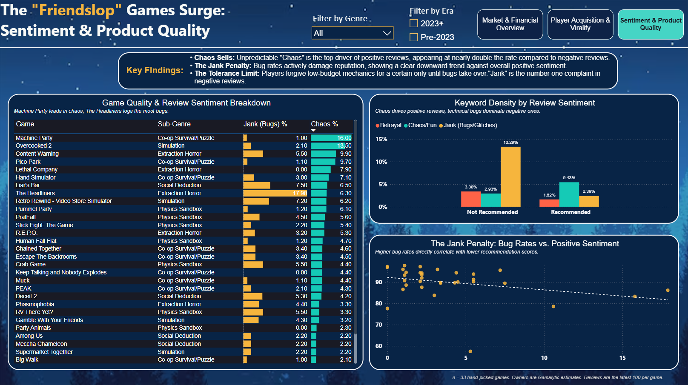

# Friendslop: Viral Peaks, Not Bigger Audiences

**An analysis of 33 social multiplayer games and 3,000+ player reviews, built with SQL Server and Power BI.**

> "Friendslop" is an informal community term for cheap, chaotic co-op and social multiplayer games built around playing with friends. It is a market/community label, not a quality judgment. This project tests what the data say about why the sub-genre took off.

**[View the live interactive dashboard](https://app.powerbi.com/view?r=eyJrIjoiMDU2YmEzZDgtOTU4Zi00MDk2LThlYjMtYTI5Nzc5Nzk1NzE2IiwidCI6IjBmZWQwM2EzLTQwMmQtNDYzMy1hOGNkLThiMzA4ODIyMjUzZSIsImMiOjEwfQ%3D%3D)** | [Static PDF](dashboard/Friendslop_Dashboard.pdf) | [Power BI file](dashboard/Friendslop_Dashboard.pbix)



---

## 1. Business question

Why did the friendslop sub-genre take off between 2023 and 2026, and what separates the games that reach big audiences and big live crowds from the rest?

Sub-questions:
1. Did newer (2023+) games reach larger audiences than older social multiplayer games?
2. Which price points, sub-genres, and social features go with the biggest audiences and the most engaged players?
3. Do "chaos" and "jank" in player reviews relate to sentiment or to sales?

## 2. Key findings

All findings describe **these 33 hand-picked games**, not the whole market. They are associations, not causes.

| # | Finding | Evidence |
|---|---|---|
| 1 | **2023+ games peak about 3.4x higher, but do not have larger audiences.** | Median peak concurrent players: 71K (2023+) vs 21K (pre-2023). Median owners: 6.6M vs 8.5M. Total owners: 159M vs 191M, despite 20 vs 13 games. |
| 2 | **The live crowds are concentrated in a few hits.** | Combined peak players for 2025 releases is about 1.0M, and Schedule I, R.E.P.O. and PEAK make up about 89% of it. |
| 3 | **$5 to $9.99 is the sweet spot among paid games.** | Highest median peak players (about 107K vs 20K to 34K in the other bands) and highest median estimated revenue (about $43M vs about $20M for under $5 and for $10+). Games at $10+ have the smallest median audience (2.3M). 12 games in the band. |
| 4 | **Players punish jank far more than they reward chaos.** | Jank words appear in 13.3% of Not Recommended reviews vs 2.3% of Recommended (about 6x). Chaos/fun words: 5.4% of Recommended vs 2.9% of Not Recommended (about 2x, but in only about 5% of reviews). |
| 5 | **Chaos language alone does not explain audience size.** | Correlation between chaos rate and log owners is near zero (r about -0.1). Jank rate vs positive review share is weakly negative (r about -0.3). |
| 6 | **Some sub-genres convert owners into live players better.** | Median peak intensity: Social Deduction 1.26%, Extraction Horror 1.19%, Simulation 1.02%, Physics Sandbox 0.90%, Co-op Survival/Puzzle 0.57%. |
| 7 | **Niche does not mean disengaged.** | Task Coordination games have the smallest median audience (1.9M owners) but the highest median peak intensity (about 1.5%). |

**Peak intensity** = all-time peak concurrent players / estimated owners. A higher value means a larger share of owners were playing at the same time.

For a developer, the data suggest that technical polish matters more than leaning into chaos: reviewers use bug-related words far more often in negative reviews, while chaos-related words are rare in both groups. This is a hypothesis from a small sample, not a tested conclusion.

## 3. Dashboard

Three pages built in Power BI Desktop, connected to SQL Server:

| Page | Purpose |
|---|---|
| **Market & Financial Overview** | KPIs, owners by price band, peak players by era, peak players by release year, owners vs peak players. |
| **Player Acquisition & Virality** | Median peak intensity by sub-genre, median owners by social feature, and a ranked table of all 33 games. |
| **Sentiment & Product Quality** | Chaos and jank keyword rates by game and by review type, and bug mentions vs approval. |

Slicers for era and sub-genre are synced across pages.

**Live dashboard:** [open it here](PASTE-YOUR-DASHBOARD-LINK-HERE). It is interactive, so click the page buttons at the top and use the era and sub-genre filters. If the link does not load, the screenshots below show every page, and a PDF export and the `.pbix` file are in `dashboard/`.




## 4. Data

### Sources
| Data | Source | Notes |
|---|---|---|
| Game-level data (release year, price, peak players, lifetime review counts, estimated owners, estimated revenue) | Steam and Gamalytic, copied by hand | Game title, Release year, Price, Peak players, Total reviews, Positive reviews, Negative reviews collected from Steam. Owners and revenue are Gamalytic estimates. All Collected October 1st 2026.|
| Player reviews | Steam, exported with the Steam reviews exporter at exportcomments.com | The 100 most recent reviews per game, collected October 1st 2026. |

**Collection method:** the game-level table was compiled manually by copying figures from each game's Steam page and Gamalytic profile into a spreadsheet. Reviews were exported per game with a third-party exporter, then translated and cleaned as described below. No scraping scripts or APIs were used.

### Game inclusion criteria
33 games were hand-picked: multiplayer/co-op games centered on playing with friends that appear in community or press discussion of friendslop or sit close to it. The list deliberately includes older social games (2015 to 2022) as a baseline against the 2023+ wave, and includes titles like: Among Us, Phasmophobia, Overcooked 2, Keep Talking and Nobody Explodes).

| | Count |
|---|---|
| Games | 33 (13 pre-2023, 20 from 2023 on) |
| Sub-genres | Co-op Survival/Puzzle (9), Physics Sandbox (8), Extraction Horror (6), Simulation (6), Social Deduction (4) |
| Key social features | Physics Sabotage (12), Proximity Chat (11), Task Coordination (7), Deception (3) |
| Paid / free | 28 / 5 |

### Data dictionary: `data/Friendslop_Data.csv` (one row per game)
| Column | Meaning |
|---|---|
| `game_title` | Game name, primary key joined to the reviews table |
| `release_year` | Year of release |
| `era` | `Pre-2023` or `2023+` |
| `sub_genre`, `key_social_feature` | Hand-assigned categories |
| `price_usd`, `price_type` | Steam price; `Free` if price is 0 |
| `peak_players` | All-time peak concurrent players |
| `positive_reviews`, `negative_reviews`, `total_reviews`, `positive_pct` | Lifetime Steam review counts |
| `estimated_owners` | Gamalytic estimate |
| `owners_per_review` | `estimated_owners / total_reviews` |
| `estimated_revenue_usd` | Estimated revenue (see limitations) |

### Data dictionary: `data/Friendslop_Reviews.csv` (one row per review, 3,300 rows)
| Column | Meaning |
|---|---|
| `review_id` | Unique number for each review |
| `game_title` | Joins to the game table (100 reviews per game) |
| `review_type` | `Recommended` or `Not Recommended` |
| `review_text` | Original review text |
| `translated_text` | English translation from Google Sheets' `GOOGLETRANSLATE` (equal to the original for English reviews) |
| `text_clean` | Translation with Steam markup removed; used for keyword matching |
| `is_usable`, `exclusion_reason` | Whether the review could be scored, and why not if it could not |
| `char_count`, `is_very_short` | Length of the cleaned text; flag for 3 characters or fewer |

## 5. Method

### Cleaning
- Trimmed stray spaces and fixed title mismatches so both tables join on `game_title` exactly (33 of 33 matched).
- Converted owners and years from text to numbers, and corrected swapped and mistyped owner and revenue values after checking them against the source.
- About half the reviews were not in English. They were translated to English with the `GOOGLETRANSLATE` function in Google Sheets; the original text is kept alongside the translation.
- Removed Steam markup (for example `[strike]` and emoticon codes) from the translated text.
- Flagged 18 reviews with failed or missing translations as unusable (kept in the table, excluded from scoring).
- Flagged 239 very short reviews (3 characters or fewer) and excluded them from scoring, since they carry no keyword signal.
- **Result: 3,043 reviews scored (82 to 100 per game).**

### Chaos Index (SQL Server)
1. Lower-case the cleaned text, replace punctuation with spaces, and pad with spaces so words match on boundaries.
2. Match keywords from an editable keyword table, using **start-of-word** matching for stems (`scream` catches screamed, screaming) and **whole-word** matching for short words (`lag`).
3. Flag each review once per bucket if it contains at least one keyword.
4. For each game, compute **the share of scored reviews that contain a keyword from each bucket** (a rate, so games with different numbers of reviews stay comparable).

| Bucket | Keywords |
|---|---|
| Chaos and fun | scream, laugh, chao (chaos/chaotic), hilarious, funny, yell |
| Jank and bugs | jank, glitch, bug, broken, crash, lag, laggy, clunky |
| Betrayal and sabotage | betray, troll, sabotag, grief, kill, steal |

**Why not plain `%word%` wildcards?** Substring matching creates false hits in gaming text: `kill` matches skill, `troll` matches strolling and controller, and `mic` matches dynamic. On this data set `%kill%` found 63 reviews against 38 for word-start matching.

### Analysis
- Medians are used throughout because owners and peak players are heavily skewed (the top five games hold roughly half of all estimated owners).
- Free games are kept in every analysis except revenue comparisons, because their revenue comes from sources the data does not capture consistently.
- Scatter plots use log scales because a few games have far larger audiences than the rest.

## 6. Limitations

- **Small, hand-picked sample (n = 33).** Groups have only 3 to 12 games, and the list likely over-represents well-known games. Games that flopped may be missing, so the results describe these games, not the genre.
- **Manual data entry.** The game-level data was copied by hand, so transcription errors are possible. Outliers were checked against the sources, and several were corrected (for example, swapped owner and revenue values for one game), but small errors may remain.
- **Owners and revenue are estimates** from Gamalytic's model and can be off. Revenue for free-to-play games is not comparable with paid games and is excluded from revenue comparisons.
- **Reviews are the 100 most recent per game**, so they reflect current player sentiment, not sentiment at launch. Time windows differ by game (a few days for a huge game, months for a small one).
- **Machine translation adds noise.** Half the reviews were translated automatically with Google Sheets' `GOOGLETRANSLATE`, which can mistranslate slang and gaming terms, and it failed on 18 reviews (excluded from scoring).
- **Keyword matching is simple.** It cannot read negation ("not buggy") or context, and most reviews contain no keyword at all (chaos words appear in about 5% of Recommended reviews, jank words in about 13% of Not Recommended ones).
- **The betrayal bucket is too sparse to analyze** (57 matches in 3,043 reviews, two-thirds from the word "kill"). It is shown for completeness only.
- **Age effects.** Older games have had years to accumulate owners, and 2026 is a partial year.
- **Peak players is an all-time peak**, not a launch peak.
- **Associations only.** None of these results show cause and effect.

## 7. Repository structure

```
friendslop-gaming-analytics/
├── README.md
├── LICENSE
├── data/
│   ├── Friendslop_Data.csv            # game-level data (33 rows)
│   ├── Friendslop_Reviews.csv         # cleaned review-level data (3,300 rows)
│   └── ChaosIndex_by_game.csv         # final Chaos Index per game (output of the SQL)
├── sql/
│   └── Friendslop_ChaosIndex.sql      # join checks, keyword table, Chaos Index, analysis queries
├── screenshots/
│   ├── page1_market_overview.png
│   ├── page2_acquisition_virality.png
│   └── page3_sentiment_quality.png
└── dashboard/
    ├── Friendslop_Dashboard.pbix
    └── Friendslop_Dashboard.pdf
```

## 8. How to reproduce

1. In SQL Server Management Studio, import the CSVs with **Tasks > Import Flat File** into `dbo.Friendslop_Data` and `dbo.Friendslop_Reviews`. Set the review text columns to `nvarchar(MAX)` and allow nulls on the text columns. (The wizard stores the Yes/No flags as `bit`, which the script expects.)
2. Run `sql/Friendslop_ChaosIndex.sql` section by section. It runs join checks, builds the keyword table, scored reviews, `dbo.ChaosIndex` and the view `dbo.vw_GameAnalysis`, and ends with the analysis queries (section 8). Requires SQL Server 2017 or newer.
3. In Power BI Desktop, connect to SQL Server and load `vw_GameAnalysis` and `ReviewBucketHits`, related on `game_title` (one-to-many).

## 9. Possible next steps

- Add more games, including flops, to reduce selection bias.
- Replace keyword matching with a sentiment or topic model.
- Pull a random sample of reviews across each game's lifetime with timestamps.
- Track how sentiment and peak players change in the weeks after launch.

## 10. Tools

SQL Server (T-SQL, SSMS), Power BI (DAX), Google Sheets (`GOOGLETRANSLATE`), Excel / CSV.
